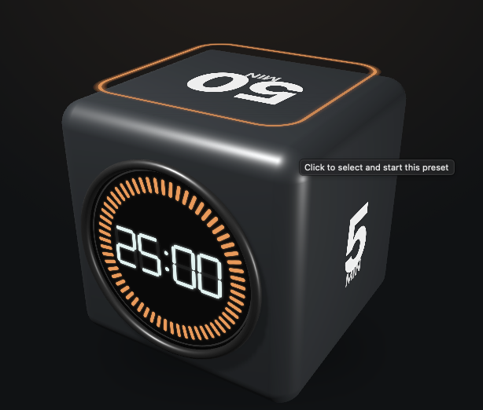
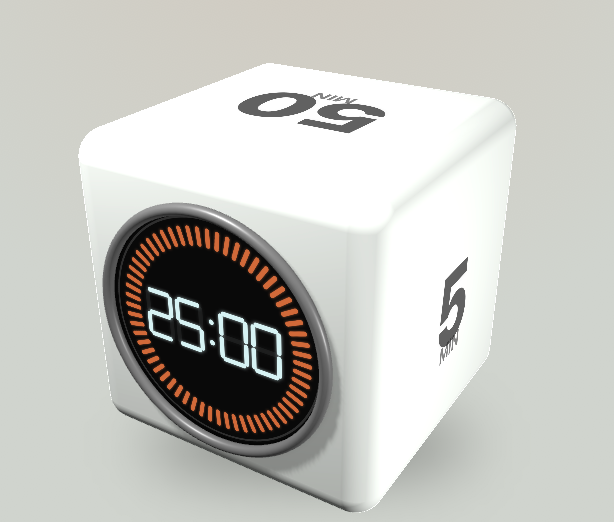
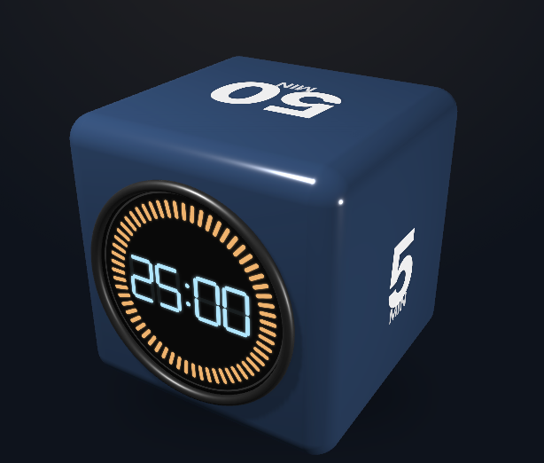
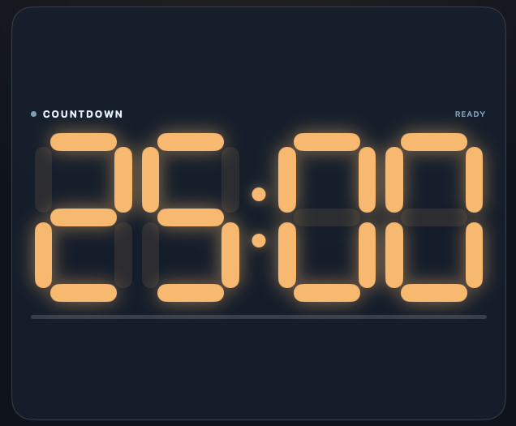

# Pomodoro Float

Pomodoro Float is a native macOS focus timer with two displays: a rotatable 3D cube and a classic seven-segment digital timer. Use it in a standard window or as a compact floating timer beside your work.

## Screenshots

| Cube · Charcoal | Cube · Light |
| --- | --- |
|  |  |

| Cube · Blue | Digital |
| --- | --- |
|  |  |

## Features

- Choose Cube or Digital display; the choice is saved between launches.
- Switch between the full standard window and a compact floating window. Keep the timer visible while working, and resize either window.
- Run customizable Pomodoro focus and break cycles, with progress, completion alerts, and session restore.
- Adjust themes, cube appearance, sounds, and timer behavior in the built-in settings.

## Requirements

- macOS 14 or later.
- A full Xcode installation with Swift 5.9 or later. The app uses SwiftUI and SceneKit; Apple Command Line Tools alone are not sufficient to build it.

## Build and run

From the repository root:

```sh
./scripts/build-app.sh
open "build/Pomodoro Float.app"
```

The script builds a release executable, packages the app icon and sounds, and ad-hoc signs the app for local use. Select the Xcode installation to use with `DEVELOPER_DIR` if needed:

```sh
DEVELOPER_DIR=/Applications/Xcode.app/Contents/Developer ./scripts/build-app.sh
```

Run the test suite with:

```sh
swift test
```

## Project map

| Area | Responsibility |
| --- | --- |
| `Sources/CubeTimer/TimerEngine.swift` | Pure countdown math, formatting, and progress. |
| `Sources/CubeTimer/TimerSessionCoordinator.swift` and `TimerSessionPersistence.swift` | Session transitions, domain events, persistence, and restore compatibility. |
| `Sources/CubeTimer/TimerModel.swift` | SwiftUI-facing timer state, preferences, and coordination of macOS effects. |
| `Sources/CubeTimer/CubeSceneView.swift` and `DigitalTimerView.swift` | SceneKit cube display and seven-segment digital display. |
| `Sources/CubeTimer/CubeTimerApp.swift` | SwiftUI app, window configuration, and timer controls. |
| `Tests/CubeTimerTests/` | Timer behavior, persistence, display, appearance, and window-layout tests. |

## Useful controls

- **Start, pause, or resume:** Click the timer or press **Space**. **Command-R** resets it.
- **Start a preset:** **Command-1** through **Command-5** starts the five default presets: 5, 10, 25, 50, and 60 minutes.
- **Settings:** Press **Command-,** to adjust durations, Pomodoro cycles, appearance, sounds, and window behavior.
- **Floating window:** Press **Command-Shift-B** to toggle it. **Control-drag** the cube to move the floating window; hold **Control** and drag its lower-right grip to resize it. Right-click for timer and window controls.

Pomodoro defaults are 25 minutes of focus, a 5-minute short break, and a 15-minute long break after four focuses. Timer sessions and preferences are saved across launches.

## License

[MIT](LICENSE)
