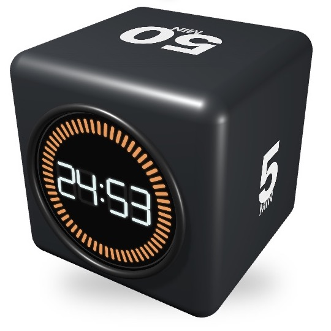

# Pomodoro Float

Pomodoro Float is a native macOS focus timer built around a rotatable 3D cube. Choose a timer on a numbered face, keep the countdown floating beside your work, and customize its appearance and sounds.



## Requirements

- macOS 14 or later.
- Full Xcode installation with a Swift 5.9 or newer toolchain. Apple Command Line Tools alone cannot build the SwiftUI app.

## Build, launch, and test

Run from the repository root (adjust the Xcode path if it is installed elsewhere):

```sh
DEVELOPER_DIR=/Applications/Xcode.app/Contents/Developer ./scripts/build-app.sh
open "build/Pomodoro Float.app"
```

The script builds a release executable, packages the sounds, and ad-hoc signs the app for local use. To run the tests:

```sh
DEVELOPER_DIR=/Applications/Xcode.app/Contents/Developer swift test
```

## Use the timer

- **Choose a preset:** The five defaults are 5, 10, 25, 50, and 60 minutes. Click a numbered cube face or press **Command-1** through **Command-5** to select and start it. Preset buttons in the standard window only select; press **Start** when ready. You can edit their durations in **Settings → Timer → Presets & Long Break**.
- **Start, pause, or resume:** Click the countdown, press **Space**, or use the visible control. **Reset** or **Command-R** returns the selected timer to its full duration.
- **Rotate the cube:** Drag it to inspect the other faces. Click the viewfinder to bring the countdown face back without changing the timer.
- **Resize or float:** Drag an edge or corner of the standard window to resize it. Press **Command-Shift-B** to toggle the transparent borderless cube. In borderless mode, **Control-drag** the cube to move it; hold **Control** and drag the lower-right grip to resize it. Right-click the cube for window controls.
- **Customize:** Open **Settings** with **Command-,**. The **Timer**, **Appearance**, **Window**, and **Sound** tabs group Pomodoro settings, cube styling, window behavior, and alerts. Duration and cycle-target edits save with **Done**; other controls apply immediately. In-app volume is in **Sound**; macOS controls notification sound when the app is hidden or closed.

For focus and break cycles, turn on **Auto-cycle focus and break** in **Settings → Timer**. The defaults are a 25-minute focus, 5-minute short break, and 15-minute long break after four focuses. Timer state and settings are saved across launches.
